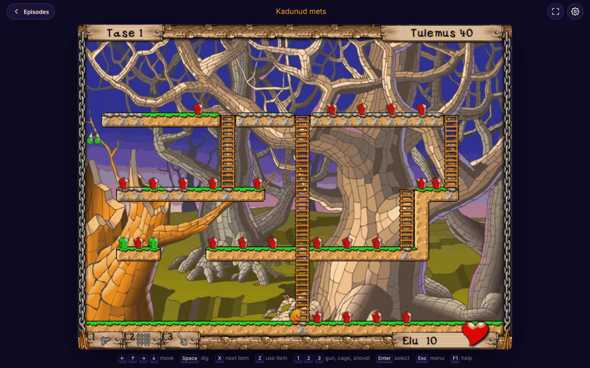
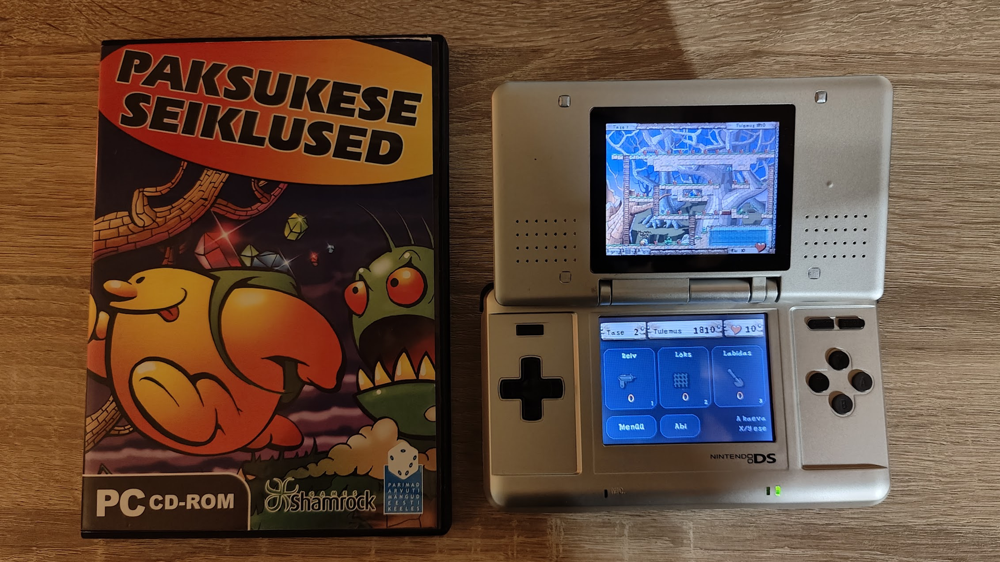

# Paksukese seiklused, recompiled

An experiment with **Claude Opus 5.5**. The goal was to take *Paksukese seiklused* (Another Day / Shamrock Games, 2003), an Estonian CD game from my childhood, and get it running in a web browser and on a Nintendo DS. Claude rebuilt the original Windows program as portable code instead of emulating a PC.

## What came out of it

- **Browser and phone version.** All four episodes from the CD, compiled to WebAssembly. You can play with a keyboard or with touch controls. It has an on-screen keyboard for typing names and its own volume settings, and it keeps save games in the browser.
- **Nintendo DS version.** Episode 1 as a `.nds` file that runs on an original DS from a flashcart. The game is on the top screen. The touch screen shows the level, score and lives, plus item cards you tap to use. The D-pad moves and A digs. Saves go to the SD card.

## How it was done

1. Unpacked the game's own file formats: images, levels, music and sound effects.
2. Decompiled the Free Pascal program and its episode DLLs to C with Ghidra's decompiler. Then checked the translated functions against the original machine code in the Unicorn CPU emulator until their results matched.
3. Replaced the Windows parts (windows, graphics, sound) with a small platform layer:
   - **Browser:** canvas drawing, Web Audio and touch input.
   - **DS:** the 3D engine draws the sprites, maxmod plays the sound, and the touch screen holds the extra panel.
4. Built the web version with Emscripten and the DS version with BlocksDS.
   - **Automated tests:** headless Chromium for the web version and the melonDS emulator for the DS version.
   - **Real hardware:** I played the DS version on my own console.

Squeezing the game into the DS's 4 MB of RAM took the most care. The PC version's memory was packed into small regions. The 8 MB of save slots are streamed to the SD card instead of being held in memory. Graphics are streamed into video memory in small tiles as they're needed.

## Notes

The game, its art and its music belong to Another Day / Shamrock Games. This port was made from my own CD for personal use.
